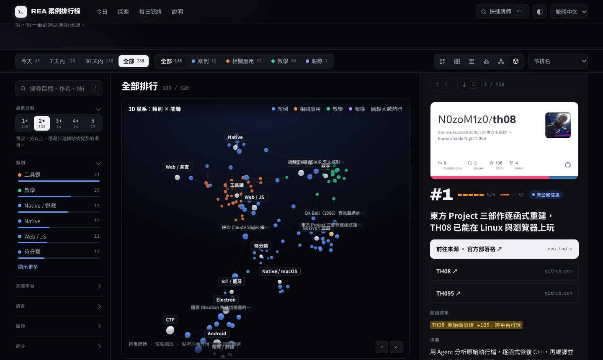

# REA 案例排行榜 · REA Case Rankings

**一頁看懂全世界的人用 [REA](https://github.com/morluto/rea) 拆開了什麼。**

REA（Reverse Engineer Anything）讓 Claude Code、Codex 這類 coding agent 直接分析沒有原始碼的程式。這個網站收集全世界用它做出來的事：復刻 App 功能、重建老遊戲、拆解韌體、做資安檢查。每一筆都用同一套 1–5 分標準評分，依熱度排名，並連回原始來源。資料每天更新兩次，介面提供繁中、簡中與英文。

*A daily-updated, scored ranking of what people build and discover with REA: app clones, game rebuilds, firmware and security findings. Every entry links to its source. Available in Traditional Chinese, Simplified Chinese and English.*

**→ https://miles990.github.io/rea-awesome/**


## 能用它做什麼

| 你是… | 打開網站就能 |
|---|---|
| 想知道 REA 能做什麼的人 | 首頁直接看到今天的重點、今日焦點案例和數字；點「全部」看歷來最強的 5 分案例 |
| 想追最新動態的人 | 預設顯示「今天」，可切換 7 天內、30 天內、全部；「每日脈絡」整理每天的趨勢與長期訊號 |
| 研究者或開發者 | 依類別、來源平台、語言、驗證程度、分數篩選；表格排序；節點圖與 3D 星系看案例之間的關聯 |
| AI agent | 讀 [`api/records.json`](https://miles990.github.io/rea-awesome/api/records.json)、[`api/daily.json`](https://miles990.github.io/rea-awesome/api/daily.json)、[`llms.txt`](https://miles990.github.io/rea-awesome/llms.txt) 或 [RSS](https://miles990.github.io/rea-awesome/feed.xml)；網址本身就是狀態，可直接開啟特定篩選與項目 |


## 功能

- **今日首頁**：當天簡報、今日／7 天／累計／REA 星數四個數字、今日焦點卡片；背景的星空是每一筆項目（橫軸日期、縱軸分數）
- **時間範圍**：今天（預設）、7 天內、30 天內、全部，計數即時更新
- **六種同步檢視**：清單、卡片、表格、時間 × 分數泡泡圖、關係節點圖、3D 星系（需要時才載入程式庫）
- **子母畫面**：右側詳情窗格含來源連結、關鍵成果、摘要、關聯網路小圖與相關項目；手機上改成抽屜
- **可收合的篩選欄**：每組篩選都有即時計數長條，開合狀態會記住
- **自動封面**：沒有預覽圖的項目，依目標名稱、平台與類型產生封面
- **鍵盤操作**：`⌘K` 跳到任何項目、`/` 搜尋、`J`/`K` 上下、`O` 開來源、`1`–`6` 切換檢視
- **網址即狀態**：`?range=7&q=firmware&type=case&view=graph#r-<id>`，可分享，也能讓 agent 直接開啟
- 淺色／深色、手機到寬螢幕都可用；尊重「減少動態效果」設定



## 排名方式

1. **分數 1–5**：人工或 AI 依同一套準則評分（5 = 可驗證的重大成果，1 = 新聞或只提到 REA）
2. **熱度 0–100**：星數、HN 分數、讚數各算 1，討論票算 3，每 100 次觀看算 1，取對數換算
3. 再依驗證程度（有測試 > 有成果 > 作者自述），最後依日期

## 每天怎麼更新

收集與評分都在維護者的 Mac 上執行，訂閱憑證（Claude、Grok、瀏覽器登入）不離開本機；GitHub 只負責建置與部署。

| 時間（台灣） | 在哪裡 | 做什麼 |
|---|---|---|
| 08:18、12:30 | 本機 launchd：`scripts/local-daily.sh` | 收集 GitHub、Hacker News、X（Grok）、Reddit（OpenCLI）、YouTube、Bluesky、Mastodon、DEV、Qiita、V2EX → Jev 篩選 → Claude 評分、翻譯、寫每日簡報 → 驗證 → 推到 repo |
| 接著 | GitHub Actions（`skip_collect=true`） | 縮圖、資料驗證、建置、**Playwright 瀏覽器檢查**（失敗就不部署）→ GitHub Pages |

Mac 睡眠時錯過的排程會在喚醒後補跑。GitHub Actions 沒有自己的排程，只能由 repo 擁有者觸發。

## 開發

```bash
npm install && npx playwright install chromium
npm run dev                       # validate → build → 瀏覽器檢查
node scripts/check.mjs --shots    # 另存截圖到 dist/shots/
```

| 腳本 | 用途 |
|---|---|
| `scripts/collect.mjs collect\|score\|all\|x` | 蒐集、評分、或只跑 X |
| `scripts/translate.mjs` | 只翻譯 2 分以上、內容有變更的項目（英文、簡中） |
| `scripts/daily.mjs` | 每日快照、簡報與本週趨勢 |
| `scripts/thumbs.mjs` | 下載並縮小預覽圖；SVG 經安全過濾 |
| `scripts/validate.mjs` | 資料結構、連結安全、重複來源、翻譯與介面字串覆蓋 |
| `scripts/build.mjs` | 產生各語言頁面、JSON、llms.txt、RSS、sitemap |
| `scripts/check.mjs` | Playwright：主控台錯誤、水平溢出、未翻譯字串、首頁、時間範圍、六種檢視與互動；5 種螢幕與深淺色 |

網站是單一靜態頁（`site/index.html`、`site/app.css`、`site/app.js`、`site/ui.json`），資料在建置時嵌入，不需要伺服器。想新增或修正案例，改 `data/cases.json` 後開 PR。

## 安全設計

- 收集與評分只在本機執行；GitHub 上沒有 Claude 或 Grok 憑證。
- Workflow 只由 `workflow_dispatch` 觸發，沒有 `pull_request` 觸發；所有 Actions 釘選 commit SHA。
- 抓到的內容一律視為不可信：Claude 以 `--tools ""`、`--max-turns 1` 執行，輸出只取白名單欄位並限制長度；頁面輸出全部 HTML 跳脫，連結只允許 http(s)；SVG 縮圖拒絕腳本、事件屬性與外部連結。

## 授權

程式碼以 [MIT License](LICENSE) 授權。各案例的內容、截圖與商標屬於原作者，本站只做索引與摘要。逆向他人軟體前，請先確認授權條款與當地法律。
