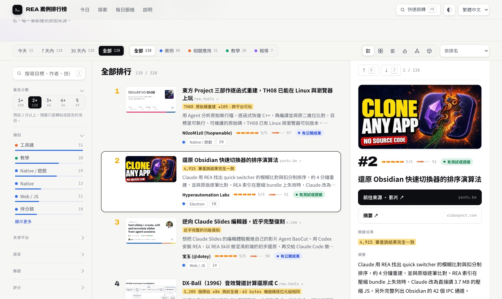

# REA Case Rankings · REA 案例排行榜

**See what people around the world took apart with [REA](https://github.com/morluto/rea), ranked and updated daily.**
**一頁看懂全世界的人用 [REA](https://github.com/morluto/rea) 拆開了什麼，每天更新。**

### → [miles990.github.io/rea-awesome](https://miles990.github.io/rea-awesome/)

---

## English

REA (Reverse Engineer Anything) lets coding agents such as Claude Code and Codex analyze programs without source code. This site collects what people do with it: app features cloned, decades-old games rebuilt, firmware and Bluetooth protocols decoded, security checks. Every entry is scored on one rubric, ranked, summarized in English and Chinese, and links back to its original source.

**What you get**

- **Today first**: the day's brief, today's top cases and the numbers that moved
- **Today / 7 days / 30 days / all time**, filters by category, platform, language and evidence
- **Six views**: list, cards, table, timeline, relation graph and a 3D map of how cases connect
- **Daily context**: what each day added and which long-term trends it supports
- **For AI agents**: [JSON](https://miles990.github.io/rea-awesome/api/records.json), [daily JSON](https://miles990.github.io/rea-awesome/api/daily.json), [llms.txt](https://miles990.github.io/rea-awesome/llms.txt), [RSS](https://miles990.github.io/rea-awesome/feed.xml); every filter lives in the URL

### How entries are collected

The collector searches public sources in many languages: GitHub, Hacker News, X, Reddit, YouTube, Bluesky, Mastodon, DEV, Qiita and V2EX. Mirrors, list repos and duplicates are dropped. A small judgment model filters out posts that are off-topic before anything is scored.

### How entries are scored

| Score | Meaning |
|---|---|
| **5** | Major verifiable result: a playable or usable rebuild, large test suites matching the original, a significant hardware or firmware finding |
| **4** | Usable result or important finding on a specific target, with some evidence |
| **3** | Hands-on test or analysis of a specific target with clear conclusions |
| **2** | Tools, integrations, tutorials, small experiments |
| **1** | News, rewrites, commentary, or only a mention of REA |

Curated entries are scored by hand; new finds are scored by Claude on the same rubric. Ties are broken by **heat** (0–100, log-scaled stars, points, likes, upvotes ×3 and views ÷100), then by evidence (tested > shipped > self-reported), then by date.

---

## 中文

REA（Reverse Engineer Anything）讓 Claude Code、Codex 這類 coding agent 直接分析沒有原始碼的程式。這個網站收集全世界用它做出來的事：復刻 App 功能、重建幾十年前的遊戲、解開韌體與藍牙協定、做資安檢查。每一筆都用同一套標準評分、排名，附中英文摘要，並連回原始來源。

**你可以**

- **先看今天**：當天簡報、今日焦點案例與關鍵數字
- **今天／7 天內／30 天內／全部**，再依類別、平台、語言、驗證程度篩選
- **六種檢視**：清單、卡片、表格、時間圖、關係節點圖，以及看案例如何相連的 3D 星系
- **每日脈絡**：每天新增了什麼、支持哪些長期趨勢
- **給 AI agent**：[JSON](https://miles990.github.io/rea-awesome/api/records.json)、[每日 JSON](https://miles990.github.io/rea-awesome/api/daily.json)、[llms.txt](https://miles990.github.io/rea-awesome/llms.txt)、[RSS](https://miles990.github.io/rea-awesome/feed.xml)；所有篩選都寫在網址裡

### 如何收錄

每天搜尋多種語言的公開來源：GitHub、Hacker News、X、Reddit、YouTube、Bluesky、Mastodon、DEV、Qiita、V2EX。去除鏡像、清單型 repo 與重複項目後，先由小型判讀模型濾掉離題內容，再進入評分。

### 如何評分

| 分數 | 標準 |
|---|---|
| **5** | 可驗證的重大成果：可玩或可用的完整重建、與原版逐筆一致的大量測試、硬體或韌體的重大發現 |
| **4** | 對具體目標做出可用成果或重要發現，有部分證據 |
| **3** | 對具體目標的實測或分析，結論清楚具體 |
| **2** | 工具、整合、教學或小型實驗 |
| **1** | 新聞、轉述、評論，或只是提到 REA |

人工整理的項目由人評分；新發現的項目由 Claude 依同一套標準評分。同分時依**熱度**（0–100，星數、HN 分數、讚數各算 1，討論票 ×3，觀看數 ÷100，取對數）排序，再看驗證程度（有測試 > 有成果 > 作者自述），最後看日期。

---

## License · 授權

Code: [MIT](LICENSE). Case content, screenshots and trademarks belong to their original authors; this site only indexes and summarizes. Check license terms and local law before reverse engineering software you don't own.

程式碼以 [MIT](LICENSE) 授權。各案例的內容、截圖與商標屬於原作者，本站只做索引與摘要。逆向他人軟體前，請先確認授權條款與當地法律。
